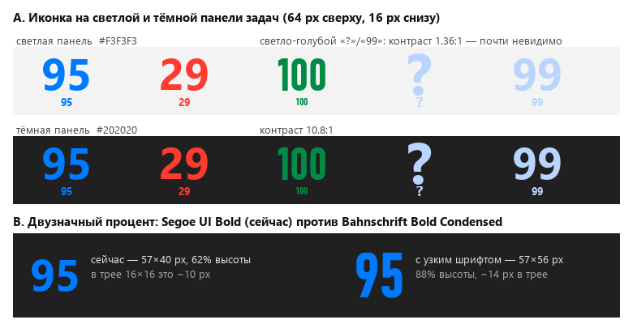

# Аудит проекта LAMZU Battery

**Версия на момент аудита:** 1.5.10 (коммит `95d5d28`, ветка `main`)
**Дата аудита:** 18.11.2026
**Объём:** 8 модулей ≈ 2990 строк; тесты — 9 файлов, 976 строк
**Режим:** только чтение кода и данных; исходники не изменялись

> **Итог:** все находки «высокие» и «средние» и большая часть «низких» исправлены,
> изменения выпущены в **[v1.5.11](https://github.com/lavandiI/lamzu-battery/releases/tag/v1.5.11)**
> 19.11.2026. Отчёт ниже сохранён как снимок состояния на момент аудита; что именно
> сделано — в разделе «Ход выполнения».

---

## 0. Кратко

Проект в хорошем состоянии. Критических дефектов, которые ломают штатный сценарий
(запуск, опрос мыши, обновление), не найдено: все 73 теста проходят, в рабочем журнале
**10 из 10 автообновлений** прошли с подтверждением здоровья нового экземпляра и
корректной остановкой старого, ни одной записи `WARNING`/`ERROR` за ~1200 строк лога,
`crash.log` пуст. Приложение живёт на 0.07 % ядра, 33 МБ памяти, без утечки дескрипторов.

Найдено **3 высоких**, **10 средних** и **37 низких** замечаний. Почти все они
касаются не «счастливого пути», а краевых сценариев: обновление при несовпадении версий,
разбор неожиданных HID-отчётов, светлая тема Windows, гонки между потоками.

**Топ-5 к исправлению:**

| # | Проблема | Риск |
|---|---|---|
| 1 | Health-check обновления сравнивает версии **строками**, а триггер — числами; CI не сверяет тег и `version.py` | бесконечный цикл «установили → откатили» каждые 6 ч у всех пользователей |
| 2 | Откат не останавливает новый экземпляр: `terminate()` в onefile убивает только bootloader-родителя | два экземпляра в трее, «откат» при живом новом процессе |
| 3 | Разбор Compx принимает любой отчёт ≥ 7 байт с первым байтом `0x04` | неверный процент на иконке |
| 4 | Ошибки скачивания/установки считаются успехом | повтор через 6 ч вместо 1/5/15/60 мин, как обещает README |
| 5 | Палитра иконки не адаптируется к светлой панели задач (1.36:1) | «нет данных» и цифры почти невидимы на светлой теме |

---

## Ход выполнения

Обновляется по мере исправления находок.

| Задача | Статус | Что сделано |
|---|---|---|
| **U1.** Нормализованное сравнение версий + свежий `heartbeat` в health-check; CI-сверка тега | ✅ готово | `updater.same_version()`, `_wait_for_new_instance(..., started_at)`, шаг «Check version matches the tag» в `release.yml`, +5 тестов (всего 78) |
| **U2.** Откат должен останавливать новый экземпляр | ✅ готово | `_stop_process_tree()`: `taskkill /PID … /T /F` + фолбэк на `kill()`; `_reacquire_instance_mutex(timeout)` ждёт освобождения мьютекса; файлы не трогаются, пока новый экземпляр жив; +11 тестов (всего 89), покрытие 47 % → **52.9 %**, `app.py` 23.6 % → **36.9 %** |
| **H1.** Ужесточить разбор Compx | ✅ готово | поймал реальный кадр с донгла (`08 04 … 02 5f 00 10 05 … d3`) и зафиксировал раскладку в тестах; три раскладки теперь требуют точной длины (17 / 16 / 16) и нулевого заголовка, у «без ID» проверяется сдвинутая контрольная сумма; хвост 10–15 намеренно не проверяется (недокументирован). +6 тестов (всего 95), `lamzu.py` 48.8 % → 51.3 % |
| **U3.** Ошибки download/install → `False`, чтобы работал backoff | ✅ готово | busy, preflight, download, replace и Popen-ошибки теперь возвращают `False` — повтор идёт по расписанию 1/5/15/60 мин, как обещает README; «нет обновления» и успешная установка по-прежнему `True`; +5 тестов (всего 100) |
| **U4.** Ветвить сообщение об откате по `restored` | ✅ готово | сделано вместе с U2: три отдельные формулировки (не удалось остановить / откат удался / откат не удался) |
| U5. Не оставлять установку без exe | ✅ готово | `rollback_executable` восстанавливает цель из бэкапа, даже если самой цели нет; после неудачной замены `_check_updates` проверяет `target.is_file()` и при необходимости откатывает файл, а если бэкап тоже потерян — просит скачать релиз; неудачный откат после ошибки запуска больше не проглатывается; +6 тестов (всего 135) |
| U6. Бэкап удалять не через 5 с, а на следующем старте | ✅ готово | `BACKUP_GRACE_PERIOD = 1 ч`: копия для отката живёт час после успешного старта (поток прерывается по `_stop`), затем удаляется; `prepare_update_target` теперь снимает и свежий бэкап, поэтому следующее обновление не блокируется; при старте убирается копия старше 24 ч; README (EN/RU) переписан; +3 теста (всего 114) |
| H2. Порядок проверок в `_model_from_product` | ✅ готово | суффиксы «… Wireless Mouse» срезаются до проверки на приёмник (`"LAMZU Maya X Wireless Mouse"` → `Maya X`); `rank()` вынесен в `_rank()` и штрафует как донгл только PID вне `_WIRED_IDS`, поэтому кабель больше не может оказаться после донгла; +3 теста (всего 105) |
| T1. Палитра под светлую панель | ✅ готово | `PALETTE_DARK`/`PALETTE_LIGHT`, `taskbar_uses_light_theme()` читает `SystemUsesLightTheme`; тема перечитывается на каждом опросе, иконка перерисовывается в новой палитре; цвета светлой темы дают 5.2–6.0:1 на `#F3F3F3` (было 1.36:1 у «нет данных»); тесты контраста и детекта темы, +7 (всего 121) |
| T2. Меню обновлять только при изменении подписей | ✅ готово | `_sync_menu()` сравнивает пару `(display_name, menu_status)` и перестраивает меню только при изменении; в фоне больше нет `update_menu()` каждые 20 с (единственный прямой вызов остался внутри `_refresh_menu`); обработчики языка/автозапуска/автообновления переведены на `_refresh_menu()`; +2 теста (всего 107) |
| C1. Уникальная проба каталога данных | ✅ готово | `_is_writable_dir()` с пробой `.write_test-<pid>` (два экземпляра больше не мешают друг другу) и гарантированной уборкой; каскад `BASE_DIR/data` → `%LOCALAPPDATA%` → `%TEMP%`, ни один шаг не бросает исключение на import; пустой `LOCALAPPDATA` больше не превращается в относительный путь; выбранный каталог пишется в лог при старте; +5 тестов (всего 112) |
| C2. `utf-8-sig` для JSON | ✅ готово | `_load_settings` и `_read_status` читают BOM-файлы; проверено тем же пробником, что падал на аудите: `settings.json` с BOM больше не сбрасывает язык и режим обновлений; +2 теста (всего 102) |
| T3. Снимок состояния под блокировкой | ✅ готово | `_state_lock` + `_state_snapshot()`: `_apply`, `_tooltip`, `_menu_status`, `_display_name`, `_interval` и `_write_status` читают одно и то же состояние; `_write_status` больше не воскрешает `running: true` после остановки; +5 тестов (всего 140), покрытие `app.py` 36.9 % → **54.3 %**, общее 52.9 % → **61.9 %**; все высокие и средние находки закрыты |
| L28. `install_exception_logging` до `setup_logging` | ✅ готово | обработчик исключений ставится первым; `setup_logging()` больше не бросает: папка данных → `%TEMP%\LamzuBattery.log` → логирование отключается, приложение продолжает работу; повторный вызов не дублирует хендлер; +5 тестов (всего 126); smoke-запуск из исходников подтвердил порядок |
| L23. Узкий шрифт для двузначных | ✅ готово | `_use_condensed()`: узкий шрифт для всех значений из 2+ цифр — «95» выросло с 40 до 56 px высоты (из 64), «42» до 54; одиночная цифра остаётся Segoe UI Bold; `docs/preview.png` перегенерирован актуальным `render_icon` (теперь совпадает с реальностью); README (EN/RU) поправлен; +3 теста (всего 129) |
| CI. Линтер, покрытие, сборка в CI | ✅ готово | `pyproject.toml` (`[tool.ruff]` E/F/W/I/B, line-length 100; `[tool.pytest.ini_options] testpaths`); ruff и pytest-cov добавлены в `requirements-dev.txt`; в `tests.yml` — `ruff check .`, покрытие с порогом **55 %** (факт 60.2 %), `compileall` по всем модулям вместо списка из пяти; `release.yml` теперь тоже прогоняет lint и тесты до сборки (тег не запускает `tests.yml`); три находки ruff исправлены |
| Документация D1–D6 | ✅ готово | «Install X.Y.Z» вместо «vX.Y.Z» (EN/RU); в таблице моделей отмечен проверенный 1K-донгл `3554:F50D`; в разделе обновлений — обязательный `digest`, запись в `NotifyIconSettings` и адаптивная палитра; новый раздел «Troubleshooting» / «Если что-то пошло не так» (5 сценариев); добавлена команда `ruff check` в раздел сборки; превью перегенерировано (D2) |
| Диагностика `diagnose.py` | ✅ готово | публичные `lamzu.is_lamzu`/`as_int` вместо копии эвристики в diagnose; `hid.enumerate()` под `try`; флаг `--raw` печатает сырые HID-отчёты через новый `lamzu.probe_reports()` (проверено на донгле: `08 04 00 00 00 02 5f 00 10 05 … d3`); код возврата 1, когда устройство не найдено или мышь не ответила; код разбит на `_print_devices`/`_print_raw`/`_print_reading`; +7 тестов (всего 147) |
| Укрепление апдейтера L1/L5/L6 | ✅ готово | после `target → backup` выставляется `os.utime(backup, None)` — копия больше не выглядит старой; preflight отклоняет read-only exe до скачивания; у скачивания общий дедлайн 15 мин, а не только таймаут сокета; +3 теста (всего 150) |
| Надёжность трея L15/L16/L20/L21 | ✅ готово | `_poll()` возвращает `bool`, и watcher обновляет подпись устройств только после реального опроса (событие не теряется); `_poll_safely()` не даёт потоку опроса умереть от неожиданного исключения; `_notify()` возвращает `bool` и не ставит флаг, если иконка ещё не видима или balloon не доставлен — уведомление повторится; «заряжена» получила гистерезис 95 %; +7 тестов (всего 157), покрытие 60 % → **63 %** |
| Полировка L25/L26/L27/L30/L31 | ✅ готово | флаг `--version`; меню языков строится циклом по `i18n.LANGUAGES` (действие через замыкание — pystray проверяет число аргументов); tmp-файлы настроек и статуса уникальны по pid и удаляются при ошибке записи; дескриптор `crash.log` закрывается, если `faulthandler.enable` не сработал; ошибка миграции автозапуска пишется в лог; +6 тестов (всего 163) |
| Чистка мелочей L2/L14/L29/L34/L35/L37 | ✅ готово | проверка URL релиза без учёта регистра (имена на GitHub нечувствительны к регистру); удалены мёртвые `BatteryReading.state_text` и `UpdateInfo.tag/page_url`; автозапуск сравнивается через `os.path.normcase`; `tray_visibility` не теряет найденные записи при ошибке перебора и повторяет запись `IsPromoted` перед тем, как вернуть ошибку; +6 тестов (всего 169), покрытие 63 % → **65 %**, `tray_visibility.py` 54 % → 74 % |
| **Релиз** | ✅ выпущено | `chore: release 1.5.11`, тег `v1.5.11`; release-workflow прошёл проверку тега, lint, тесты и сборку; ассет 17 119 064 Б с digest `sha256:7b0e7d83…`; релиз опубликован 19.11.2026. Живая проверка: работавшая 1.5.10 сама обновилась до 1.5.11 за 8 с (скачивание → замена → hand-off мьютекса → health-check), SHA-256 установленного exe совпал с релизным |

---

## 1. Методика

Что делалось:

1. **Построчное чтение** всех модулей (`app.py`, `lamzu.py`, `updater.py`, `i18n.py`,
   `tray_visibility.py`, `diagnose.py`, `version.py`, `make_icon.py`) и всех тестов.
2. **Динамика:** `pytest -q` (73 теста), повторный прогон с `-W error::DeprecationWarning`,
   `py_compile` всех модулей.
3. **Покрытие** — трассировка через стандартный `trace` (без установки пакетов).
4. **Статический анализ** — ruff 0.17.5 (поставлен во временную папку, в проект не
   устанавливался) + собственный AST-скан на неиспользуемые импорты и мёртвые функции.
5. **Живой прогон** рабочего экземпляра: `dist/data/app.log`, `status.json`,
   `settings.json`, CPU/RAM/дескрипторы/потоки за 45 с.
6. **Железо:** реальный донгл LAMZU (`3554:F50D`, Compx) — `hid.enumerate()`,
   `discover_devices()`, попытка `read_battery()`; проверка парсеров на синтетических кадрах.
7. **Симуляция апдейтера** с моками: успешное обновление, неудачный health-check,
   неудачный откат.
8. **Проверка GUI-стека:** исходники `pystray 0.19.5` (win32 backend), поведение
   `update_menu`, `notify`, `TrackPopupMenuEx`.
9. **Оценка контраста** цветов иконки на светлой/тёмной панели + замер геометрии цифр.
10. **Ревью** CI, сборки, релизного процесса, `.gitignore`, документации, git-истории.

---

## 2. Метрики

| Показатель | Значение |
|---|---|
| Модули / строки | `app.py` 1266, `updater.py` 590, `lamzu.py` 567, `i18n.py` 239, `tray_visibility.py` 172, `diagnose.py` 110, `make_icon.py` 44, `version.py` 3 |
| Тесты | 73 passed за 1.5 с, без предупреждений |
| Покрытие строк (трассировка) | всего **47.0 %**; `i18n` 94.1 %, `updater` 73.9 %, `tray_visibility` 55.4 %, `lamzu` 48.8 %, **`app.py` 23.6 %** |
| ruff (набор по умолчанию 0.17.5) | 70 замечаний: 41 `UP045`, 18 `BLE001`, 6 `S110`, 2 `RUF100`, 1 `UP035`, 1 `SIM115`, 1 `I001`; плюс 9 строк длиннее 88 |
| Неиспользуемые импорты / мёртвый код | нет в рабочем коде (кроме `from __future__`) |
| `LamzuBattery.exe` | 17.1 МБ, onefile, без консоли |
| Рабочий процесс | 33.2 МБ WS, 5 потоков, 232 дескриптора (стабильно), **0.07 % CPU** в простое |
| Живое устройство | `3554:F50D` (Compx, интерфейс 1), 99 % (raw 95, 4109 мВ), модель не определяется |
| Журнал | ≈1200 строк, 10 обновлений 1.5.1→1.5.10, 10× `healthy`, 10× `tray stopped`, 0 ошибок |
| Git | 26 коммитов, Conventional Commits, рабочее дерево чистое |

Покрытие измерения:

```
app               229/ 969   23.6 %
lamzu             180/ 369   48.8 %
updater           326/ 441   73.9 %
i18n              177/ 188   94.1 %
tray_visibility    72/ 130   55.4 %
version             2/   2  100.0 %
TOTAL             986/2099   47.0 %
```

---

## 3. Высокие

### U1. Health-check обновления сравнивает версии строками, а не числами

`app.py:835-839`, `updater.py:111-120`, `version.py:3`, `.github/workflows/release.yml`

Триггер обновления сравнивает версии численно (`updater.is_newer`), а подтверждение
готовности нового экземпляра — посимвольно:

```python
if (
    str(status.get("version") or "") == version      # "1.6.0" == "1.6" -> False
    and status.get("healthy") is True
):
```

Достаточно, чтобы тег релиза и `version.py` разошлись по форме (`v1.6` против `1.6.0`,
`v1.6.0.1`, суффикс), и получается вечный цикл: обновление скачивается (17 МБ),
устанавливается, 30 с ждёт health, не дожидается, откатывается — и через 6 часов
повторяется. Никакой тест или CI это не поймает: сверки тега с `APP_VERSION` нет.

Дополнительно: в `status.json` не проверяется «свежесть» (`heartbeat_unix`, `pid`, nonce).
Старый `status.json` от предыдущей попытки с тем же `version` и `healthy: true` будет
принят за доказательство успешного старта. Сравнивать с `process.pid` нельзя: в onefile
`os.getpid()` — это pid дочернего процесса, а `Popen` возвращает pid bootloader-родителя.

**Исправление:**

```python
# app.py, _check_updates: запомнить момент запуска и требовать свежий heartbeat
started_at = int(time.time())
...
if (
    updater.parse_version(str(status.get("version") or ""))
    == updater.parse_version(version)
    and status.get("healthy") is True
    and int(status.get("heartbeat_unix") or 0) >= started_at
):
```

и в `release.yml` перед сборкой:

```yaml
- name: Check version matches tag
  shell: pwsh
  run: |
    $v = (Select-String version.py 'APP_VERSION\s*=\s*"([^"]+)"').Matches[0].Groups[1].Value
    if ("v$v" -ne "${{ github.ref_name }}") { throw "version.py ($v) != tag" }
```

### U2. Откат не останавливает обновлённый экземпляр

`app.py:985-990`, `app.py:1007-1019`

В onefile-режиме PyInstaller запускает дочерний процесс: `Popen` возвращает
bootloader-родителя, который ждёт ребёнка (на этой машине видны ровно два процесса
`LamzuBattery` с разницей старта в 1 с). `process.terminate()` убивает только родителя —
**дочерний процесс новой версии продолжает жить** и может уже держать мьютекс трея.

Дальше сценарий такой: старый процесс откатывает файлы, запускает восстановленную версию с
`--wait-for-instance`, та 45 с ждёт мьютекс и выходит «another instance is already running»,
а в трее остаётся новый экземпляр. На диске старая версия, в памяти новая, сообщение
говорит «the previous version was restored». `_reacquire_instance_mutex()` в ветке
`else` возвращает `bool`, но результат нигде не проверяется — процесс может остаться без
защиты от второго экземпляра.

**Исправление:** запускать обновление в Job Object с `JOB_OBJECT_LIMIT_KILL_ON_JOB_CLOSE`
(или `taskkill /T /F` по pid), после `terminate()` дождаться, что tray-мьютекс можно
захватить, и только затем откатывать файлы; проверять результат `_reacquire_instance_mutex`.

### H1. Слишком мягкий разбор Compx-ответа

`lamzu.py:349-356`

Ветка «ответ без report ID» проверяет только `len(data) >= 7 and data[0] == 4`:

```python
elif len(data) >= 7 and data[0] == COMPX_BATTERY_COMMAND:
    raw_level, state = data[5], data[6]
    voltage_mv = _compx_voltage(data, 7)
```

Проверено на синтетике:

```
[4, 9, 9, 9, 9, 50, 1]                    -> BatteryReading(percent=50, state=1)
любой 64-байтный отчёт с data[0] == 4     -> BatteryReading(percent=86, ...)
```

То есть произвольный input-report управляющего интерфейса (эхо чужой команды, отчёт
другого ПО, мусор после смены прошивки) показывается как заряд.

Вторая проблема — ветка на 16 байт (`lamzu.py:349-352`) принимает кадр **без контрольной
суммы**, хотя те же данные длиной 17 с испорченной суммой отвергаются:

```
len=16 -> reading;  те же 16 байт + плохая сумма (17 байт) -> None
```

Строгая ветка (17 байт, `data[0]==8`, `data[1]==4`, checksum `(0x55 - sum(data[:16])) & 0xFF`)
работает корректно и проверена тестами.

**Исправление:** для «без report ID» принимать ровно 16 байт и требовать нулевые
инварианты (`data[1:5] == 0`, хвост нулевой); без-checksum ветку оставить только для
точной длины 16 и с проверкой нулевого паддинга.

---

## 4. Средние

### U3. Ошибки скачивания и установки возвращают «успех»

`app.py:922`, `app.py:935`, `app.py:950`, `app.py:724-731`

`_check_updates` возвращает `True` для неудачного preflight, неудачного скачивания и
неудачной установки. `_update_loop` трактует `True` как успех → `_next_update_delay(True, …)`
→ **6 часов**. README при этом обещает: «Transient network/GitHub errors are retried after
1, 5 and 15 minutes, then after 1 hour». Оборвавшийся Wi-Fi на 17-мегабайтной загрузке
откладывает обновление на полдня. Захват шины (`busy`) тоже сбрасывает счётчик неудач.

**Исправление:** `False` для preflight/download/replace/Popen-ошибок, `True` — только для
«нет обновления» и «успешно установлено»; `busy` не считать успехом.

### U4. Сообщение об откате всегда утверждает успех

`app.py:1011-1016`

```python
self._notify_update_error(
    manual,
    "the new version did not start correctly; "
    "the previous version was restored",
    "health",
)
```

Отправляется независимо от `restored`. Симуляция подтверждает: при неудачном откате
пользователь получает то же «всё восстановлено», хотя установка может быть повреждена.
**Исправление:** ветвить текст по `restored`; при `False` — «откат не удался, скачайте
версию с GitHub заново» и открыть страницу релиза.

### U5. Неудачная замена может оставить установку без exe

`updater.py:469-481`, `updater.py:494-495`, `app.py:943-950`

Между `os.replace(target, backup)` и `os.replace(new, target)` файла `LamzuBattery.exe`
не существует. Если вторая замена упала и восстановление из бэкапа тоже не удалось
(антивирус, диск, права), `replace_executable` только пишет в лог и бросает `UpdateError`;
`_check_updates` показывает общее «could not install update» и продолжает работать из
памяти. При выходе автозапуск и ярлык указывают в пустоту. `rollback_executable` такой
случай не лечит — при отсутствии `target` он сразу возвращает `False`.

**Исправление:** после любого сбоя установки проверять `target.exists()`; если файла нет —
восстанавливать `backup → target` с ретраями; в `rollback_executable` требовать только
бэкап и восстанавливать цель, если её нет; при полном провале — отдельное actionable-сообщение
(«переименуйте `LamzuBattery.old.exe` в `LamzuBattery.exe`»).

### U6. Бэкап для отката удаляется через ~5 секунд после старта новой версии

`app.py:1077-1096`, `updater.py:545-559`

`_mark_healthy` — это таймер на 5 с: «процесс прожил 5 секунд». Сразу после него
`cleanup_backup` удаляет `.old.exe`, как только старый процесс отпустит файл. Дефект новой
версии, проявляющийся позже (первый опрос HID, исключение в главном потоке, падение при
работе с настройками), оставляет пользователя без копии для отката, хотя README говорит
«the previous version is kept until the health check passes» — формально верно, но
«здоровье» здесь означает лишь «трей поднялся».

**Исправление:** удалять бэкап не в этой сессии, а на следующем чистом старте (или после
первого успешного опроса мыши); правило 24 часов уже покрывает уборку.

### H2. Модель теряется из-за слова «Wireless», ранг интерфейсов может стать неверным

`lamzu.py:201-206`, `lamzu.py:209-223`, `lamzu.py:294-302`

`_model_from_product` проверяет `_is_receiver_name(name)` **до** того, как срезает суффиксы
`" wireless mouse"` / `" mouse"`, а в списке «приёмников» есть слово `wireless`:

```
_model_from_product("LAMZU Maya X Wireless Mouse") -> None     (проверено)
_model_from_product("LAMZU Maya X")                -> "Maya X"
```

То есть срезание суффикса `" wireless mouse"` практически недостижимо: любое название с
этим суффиксом уже отбраковано как «приёмник». Побочный эффект: `rank()` даёт такому
устройству `+2` как «приёмнику» (`lamzu.py:296-297`), и кабель может оказаться в списке
**после** донгла, хотя `_WIRED_IDS` и docstring обещают обратный приоритет (срабатывает,
когда product-строка донгла не содержит receiver/dongle/wireless).

**Исправление:** сначала срезать суффиксы, затем проверять receiver-ключи; убрать
`wireless` из `_is_receiver_name`; штраф за «приёмник» применять только к PID, которых нет
в `_WIRED_IDS`.

### T1. Палитра иконки не адаптируется к светлой панели задач

`app.py:83-86`, `app.py:343-369`

Цвета рассчитаны на тёмную панель. На этой машине включена светлая тема
(`SystemUsesLightTheme = 1`), и на панели `#F3F3F3` получается:

| Цвет | На тёмной `#202020` | На светлой `#F3F3F3` |
|---|---|---|
| синий `#007AFF` | 4.06:1 | 3.62:1 |
| красный `#FF3B30` | 4.59:1 | 3.20:1 |
| зелёный `#008C46` | 3.75:1 | 3.91:1 |
| **светло-голубой `#B8D4FF`** | 10.78:1 | **1.36:1** |

Светло-голубой — это как раз состояние «нет данных» (спящая мышь, «?», устаревшее
значение). На светлой панели его практически не видно.



*Рисунок показывает состояние до исправления: сейчас для светлой темы используется отдельная палитра (см. «Ход выполнения»).*

**Исправление:** читать `HKCU\Software\Microsoft\Windows\CurrentVersion\Themes\Personalize\SystemUsesLightTheme`
и выбирать более тёмные варианты (например, «нет данных» `#2C5FA8`), либо рисовать
контрастную обводку/тень. Обновление — по `WM_SETTINGCHANGE`.

### T2. `icon.update_menu()` из фонового потока уничтожает показанное меню

`app.py:616-619`, `app.py:697-701`, `pystray/_win32.py`

`_poll` дёргает `update_menu()` при каждом опросе (20 с / 60 с / 5 мин). В pystray 0.19.5
это `DestroyMenu(hmenu)` + `CreatePopupMenu`, причём **в вызывающем потоке**, а показ меню
в `_on_notify` — блокирующий `TrackPopupMenuEx` с этим же `hmenu`. Если пользователь держит
меню открытым через тик опроса, меню может пропасть или «залипнуть».

**Исправление:** обновлять меню только при изменении `_menu_status()` / `_display_name()`
(сравнить с сохранённой строкой). Это убирает 99 % вызовов и заодно экономит ресурсы.
`_on_toggle_autostart`/`_on_set_language` и так вызываются на UI-потоке — там можно
оставить.

### C1. Гонка при выборе папки данных; незащищённый fallback

`app.py:55-71`

`_pick_data_dir` пишет пробный файл `.write_test` с фиксированным именем и тут же удаляет
его. Если два процесса стартуют одновременно (автозапуск + ручной запуск, либо hand-off
апдейтера), второй может получить `FileNotFoundError` на `unlink()` — это `OSError`, и
процесс молча уезжает в `%LOCALAPPDATA%\LamzuBattery`. Каталоги данных расходятся, а
health-check обновления читает `status.json` уже из другого места → ложный откат.
Плюс `fallback.mkdir()` (строка 70) не обёрнут: при недоступном `LOCALAPPDATA` будет
исключение на import, до логирования и MessageBox.

**Исправление:** уникальное имя пробы (`tempfile.mkstemp(dir=preferred)`), `try/except`
вокруг fallback, `log.info` с выбранным каталогом.

### C2. BOM в JSON сбрасывает язык и режим обновлений

`app.py:123`, `app.py:800`

`read_text(encoding="utf-8")` + `json.loads` не переносят BOM: файл, сохранённый «Блокнотом»
или редактором с BOM, молча игнорируется. Проверено: `settings.json` с BOM →
`{'update_mode': 'auto'}`, язык и режим обновлений теряются. Для `status.json` последствия
мягче (файл пишет сама программа).

**Исправление:** `encoding="utf-8-sig"` в `_load_settings` и `_read_status`.

### T3. Общее состояние читается и пишется без блокировки

`app.py:623-659`, `app.py:1032-1064`, `app.py:613`

`_poll_lock` сериализует опросчиков, но `_last`, `_last_ok`, `_online` читают `_apply`,
`_tooltip`, `_menu_status`, `_write_status` из потоков трея/таймера/апдейтера.
`_write_status` обращается к `self._last` больше десяти раз — теоретически в `status.json`
могут смешаться поля двух чтений (процент одного, состояние другого). Окно наносекундное,
поэтому это низкий практический риск, но исправляется дёшево:

**Исправление:** один `_state_lock`; в `_poll` обновлять кортеж под ним; читатели снимают
снимок один раз. В `_write_status` добавить ранний выход при `self._stop.is_set()` — сейчас
опрос может записать `running: true` уже после финальной записи `running: false`
(`app.py:1201-1204`).

---

## 5. Низкие

### Обновления

| # | Место | Суть |
|---|---|---|
| L1 | `updater.py:455-463`, `562-580` | «Бэкап старше 24 ч» определяется по `st_mtime`, а `os.replace` сохраняет mtime **исходного** exe. Бэкап, созданный только что из exe недельной давности, уже считается устаревшим. Лечится `os.utime(backup_path, None)` после переименования. |
| L2 | `updater.py:222-224` | Проверка пути ассета регистрозависима (`/lavandiI/lamzu-battery/...`). Переименование репозитория с другим регистром ломает автообновление. |
| L3 | `updater.py:296-298` | Релиз без поля `digest` установить нельзя (осознанная политика безопасности, но в README не описана). |
| L4 | `updater.py:52-90` | `WinDLL` пересоздаётся на каждый вызов; `_FILE_LOCK` (RLock) удерживается всё время ожидания named mutex (до 30 с). Дедлока нет (вложенных захватов не обнаружено), но другие потоки блокируются. |
| L5 | `updater.py:163-200` | Preflight проверяет папку и место, но не сам exe (ACL/переименование), хотя docstring обещает «fail before downloading when the exe cannot be replaced safely». |
| L6 | `updater.py:336-364` | `timeout=120` — таймаут сокета на операцию, общего дедлайна скачивания нет: «медленный» сервер держит `_update_lock` и прогресс бесконечно. |
| L7 | `app.py:1022-1026` | `_update_pending` не сбрасывается в общем `except`: неожиданное исключение после установки флага навсегда отключает запись `status.json`. |
| L8 | `app.py:974-982` | Старый процесс освобождает tray-мьютекс до подтверждения нового — третий экземпляр может его перехватить; `_reacquire_instance_mutex()` в ветке `else` не проверяется. |
| L9 | `app.py:45-46`, `1237` | `UPDATE_READY_TIMEOUT = 30 с` против 45 с ожидания мьютекса в `main()`. На практике хватает (в логе 5–6 с), но на холодном HDD с Defender 30 с может не хватить; 45 с недостижимы, потому что watchdog сдаётся первым. |

### HID и опрос

| # | Место | Суть |
|---|---|---|
| L10 | `lamzu.py:462-467`, `501-517` | У `get_feature_report` нет таймаута; `deadline` проверяется только между итерациями. Зависшее устройство может растянуть опрос за бюджет `timeout`, а `_poll_lock.acquire(timeout=5)` и `join(2)` рассчитаны на 0.5 с. |
| L11 | `lamzu.py:487-497` | Возврат `device.write()` не проверяется (`sent = True` после любого неисключения); `send_feature_report(...) >= 0` считает 0 успехом. |
| L12 | `lamzu.py:281-292` | Фильтр Aurora «только интерфейс 2» вырождается, если hidapi отдаёт `interface_number = -1` (на этой машине такое есть у одного из 23 устройств): тогда кандидатами становятся все коллекции с usage page `0xFFFF`. |
| L13 | `lamzu.py:386-425` | Aurora-разбор — набор позиционных эвристик; валидация только 0..100 / 0..3. Для непроверенного на железе протокола стоит усилить инварианты (длина 65, поле `0x02`, тег `0xA1`) и логировать сырой кадр при промахе. |
| L14 | `lamzu.py:151-158` | `BatteryReading.state_text` — мёртвый код в проде (используется только тестом), с захардкоженным русским текстом и дублирует `i18n.state_text`. При будущем вызове даст русский текст в английском UI. |
| L15 | `app.py:566-578`, `589-591` | Watcher обновляет `signature` **до** `_poll`; если лок занят, `_poll` молча возвращается и событие «воткнули кабель» теряется до следующего 20-секундного тика. |
| L16 | `app.py:561-564`, `566-578` | Нет верхнеуровневого `try/except` в циклах `_worker`/`_watch_devices`: неожиданное исключение навсегда останавливает опрос (в лог попадёт через `threading.excepthook`, но трей продолжит показывать старое значение). |
| L17 | `lamzu.py:306-316`, `app.py:569` | `present_product_ids()` — полный `hid.enumerate()` каждые 5 с (замер: 15–17 мс холодный, ~0.07 % CPU в рабочем процессе). Надёжнее `RegisterDeviceNotification`/`WM_DEVICECHANGE`, дешевле — интервал 30 с, пока мышь отвечает. |
| L18 | `app.py:580-587` | В состоянии «заряжена» опрос раз в 5 минут. Снятие кабеля ловится watcher'ом, но смена состояния без смены VID:PID — только через 5 минут. |

### Трей и UX

| # | Место | Суть |
|---|---|---|
| L19 | `app.py:774-790` | Прогресс скачивания в тултипе может быть затёрт опросом (`_apply`), если тот попадёт в окно загрузки. |
| L20 | `app.py:691-695`, `run()` | Уведомление после первого опроса может уйти раньше, чем иконка станет видимой (`_worker` стартует до `icon.run`); `_notify` это молча проглатывает. |
| L21 | `app.py:679` | У «заряжена» нет гистерезиса: сняли/поставили кабель на 100 % — приходит второе уведомление. Для «низкого заряда» гистерезис есть (15/20). |
| L22 | `app.py:507-522`, `705-715` | «Проверить обновления» и «Установить vX.Y.Z» вызывают один и тот же обработчик (`_check_updates(True)`) — две разные подписи с одинаковым действием. |
| L23 | `app.py:343-369` | Двузначные проценты занимают только ~62 % высоты иконки (57×40 из 64×64), потому что ширина — ограничивающий размер для Segoe UI Bold. Тот же узкий шрифт даёт 57×56. На 16 px в трее это ~10 px против ~14 px (см. рисунок в T1). |
| L24 | `app.py:646-659` | Для неопознанной модели в UI показывается «LAMZU Battery», хотя `status.json` знает продукт (`LAMZU Pro 1K Receiver`). Можно показывать «LAMZU 1K» или product-строку в тултипе. |
| L25 | `app.py:523-539` | Языки в меню перечислены вручную двумя пунктами; добавление языка требует правок и в `i18n`, и в `app` — стоит цикл по `i18n.LANGUAGES`. |
| L26 | `app.py:1214-1221` | Нет `--version` (и `--lang`, который есть у `diagnose.py`). |

### Файлы, автозапуск, логирование

| # | Место | Суть |
|---|---|---|
| L27 | `app.py:141-157` | `settings.tmp` — фиксированное имя; read-modify-write без блокировки; ошибки сохранения уходят только в `log.debug` (пользователь не узнает, что язык не сохранился). Коллизии с `status.tmp` нет — проверено. |
| L28 | `app.py:1223-1224`, `176-193` | `setup_logging` вызывается **до** `install_exception_logging` и не защищён: отказ `mkdir`/`RotatingFileHandler` в windowed-exe = смерть без лога и без диалога. Хендлер добавляется безусловно (повторный вызов даст дубли строк). |
| L29 | `app.py:380-386` | `autostart_enabled` сравнивает строку точно: запись на старый путь (после переноса exe) выглядит как «выключено», а мёртвая запись остаётся в реестре. |
| L30 | `app.py:245-248` | Если `faulthandler.enable` бросит, дескриптор `crash.log` останется открытым (`_FAULT_FILE = None` без `close`). |
| L31 | `app.py:421` | `_migrate_legacy_autostart` глушит любые `OSError` без лога. |

### Диагностика и реестр

| # | Место | Суть |
|---|---|---|
| L32 | `diagnose.py:51-60` | `hid.enumerate()` без `try`, `int(...)` может бросить `ValueError`; дублирует эвристику `_is_lamzu`. |
| L33 | `diagnose.py:109-110` | `main()` всегда возвращает 0: «мышь не найдена» для скриптов/CI — успех. |
| L34 | `tray_visibility.py:89-92` | `except OSError: return []` внутри перебора отбрасывает уже найденные записи; лучше `break`. |
| L35 | `tray_visibility.py:156-161` | `promote()` сдаётся после первой ошибки записи, хотя для него объявлены `MANUAL_RETRY_DELAYS`. |
| L36 | `app.py:62-67` | Если `probe.unlink()` упадёт, в папке данных остаётся `.write_test`. |
| L37 | `updater.py:96-101` | `UpdateInfo.tag`/`page_url` заполняются, но нигде не читаются. |

---

## 6. Что улучшить (не дефекты)

### 6.1 Иконка и читаемость

1. **Узкий шрифт для всех процентов.** Сейчас `condensed` включается только для трёх
   цифр (`app.py:354`). Замер: `"95"` в Segoe UI Bold — 57×40 px, в Bahnschrift Bold
   Condensed — 57×56 px при той же ширине, то есть +40 % высоты и заметно читаемее на
   16 px в трее. Компромисс — включать condensed для всех чисел, кроме однозначных.
2. **Кэш отрендеренных иконок** по `(text, color)` — сейчас каждый опрос создаёт новый
   `Image` (2–6 мс) и HICON. При 20-секундном опросе это незаметно, но бесплатно
   устраняется.
3. **Обводка/тень под цифрами** — решает и светлую тему (T1), и пёстрые обои за панелью.
4. `docs/preview.png` показывает цифры высотой ~60 px из 64, а текущий рендер даёт 40 px
   для двузначных. Картинку стоит перегенерировать из актуального `render_icon`, иначе
   она обещает больше, чем есть.

### 6.2 Опрос и питание

5. **Backoff при недоступной мыши.** Сейчас 20 с навсегда (`app.py:105`, `580-587`): за
   час это 180 HID-транзакций, каждая будит USB-радио. Схема 20 с × 3 мин → 60 с × 15 мин
   → 5 мин даст тот же UX при меньшем расходе.
6. **`WM_DEVICECHANGE` вместо опроса** `hid.enumerate()` каждые 5 с — точнее и дешевле
   (L17).
7. Первый опрос при старте логично делать **после** `_on_icon_ready`, чтобы уведомления
   не терялись (L20).

### 6.3 Архитектура и тестируемость

8. `app.py` на 1266 строк — это конфиг/пути, иконки, автозапуск, контроллер обновлений и
   трей в одном модуле. Разрезать на `config.py`, `icons.py`, `autostart.py`,
   `updates_controller.py`, `tray.py` — заодно появится возможность тестировать логику без
   `pystray`/`hid`.
9. `DATA_DIR`, `STATUS_FILE`, `SETTINGS_FILE` вычисляются на import — из-за этого
   `import app` создаёт `data/` в рабочем дереве, а тесты вынуждены монкипатчить
   модульные глобалы. Лучше передавать объект путей в `BatteryTray`.
10. `i18n`-меню по циклу `i18n.LANGUAGES`; убрать мёртвый `BatteryReading.state_text` (L14).
11. Вынести `_is_lamzu` в публичную функцию и переиспользовать в `diagnose.py` (L32).

### 6.4 Диагностика для issue-репортов

12. `diagnose.py` — добавить `--raw`, печатать сырые HID-отчёты в hex, результат
    `send_feature_report` и `usage/usage_page` для каждого кандидата. README просит
    прикладывать вывод diagnose, но сейчас там нет главного для разбора — байтов.
13. Добавить в `diagnose.py` код возврата 1 при «не найдено / нет ответа» (L33).

### 6.5 Безопасность и поставка

14. Подпись exe (например, SignPath для OSS) — снимает часть SmartScreen-трений; сейчас
    это честно описано в README как ограничение.
15. `--version-file` для PyInstaller: в свойствах exe появятся версия и описание —
    мелочь, но повышает доверие и помогает антивирусным эвристикам.
16. Условные запросы к GitHub (`ETag`/`If-None-Match`) — необязательно, но уменьшает
    трафик и риск лимитов при частых проверках.

---

## 7. Тесты, CI и релизный процесс

### 7.1 Покрытие

47 % строк в целом и **23.6 % в `app.py`** — это главный технический долг. Полностью
не покрыты:

* `_check_updates` целиком (успех, health-fail, rollback-fail, ошибки download/install);
* `_poll` / `_maybe_notify` / `_apply` (уведомления, цвета, устаревание значения);
* `read_battery` — выбор между кабелем и донглом, перебор кандидатов;
* `_pick_data_dir` (fallback), `autostart_*`, `_migrate_legacy_autostart`;
* `tray_visibility._entries_for` (перебор реестра), `promote()`;
* `i18n.detect_system_language`;
* `updater.rollback_executable` (сейчас не тестируется вообще, хотя это путь спасения).

Тесты, которые есть, хорошие: парсеры, версии, замена exe, настройки, i18n-паритет
(`test_languages_have_the_same_keys`) — именно то, что ломается чаще всего.

**Рекомендация:** поднять `app.py` до ~60 % за счёт моков `updater.*` и `hid`, плюс
интеграционный тест апдейтера (локальный HTTP-сервер + фиктивный exe: check → download →
replace → health → rollback). Порог покрытия в CI: 50 % сейчас, 60 % после.

### 7.2 CI

| Замечание | Место |
|---|---|
| `py_compile` проверяет 5 модулей из 8: нет `i18n.py`, `tray_visibility.py`, `make_icon.py` | `.github/workflows/tests.yml` |
| Нет линтера/форматтера/типов (ruff отдаёт 70 замечаний, 45 чинятся автоматически) | — |
| Нет порога покрытия и отчёта о покрытии | — |
| `release.yml` не запускает тесты перед публикацией | `.github/workflows/release.yml` |
| Нет сверки `version.py` с тегом (см. U1) | там же |
| Нет `concurrency`/таймаута джобов, нет `permissions` в `tests.yml` (для PR из форков это ок, но лучше явно) | оба workflow |

Что стоит завести: `pyproject.toml` с `[tool.ruff]` (`select = ["E","F","W","I","UP","B","SIM"]`,
`ignore = ["UP045"]` на первое время), `[tool.pytest.ini_options]`, `[project]` с версией
(и генерировать `version.py` или читать оттуда), `CHANGELOG.md`, `SECURITY.md`,
`.editorconfig`, `.github/ISSUE_TEMPLATE` (просить вывод `diagnose.py --raw` и модель).

### 7.3 Релиз

* Тег `vX.Y.Z` должен совпадать с `APP_VERSION` (U1) — иначе автообновление у всех
  пользователей уходит в цикл.
* Draft-релиз с `--verify-tag` — правильно; но публикация не требует зелёных тестов.
* `SHA256SUMS.txt` собирается, но нигде не используется (updater берёт digest из API) —
  либо убрать, либо упомянуть в README как ручную проверку.

---

## 8. Документация

| # | Место | Замечание |
|---|---|---|
| D1 | `README.md:151`, `README.ru.md:155` | Обещано «Install vX.Y.Z» / «Установить vX.Y.Z», а меню показывает «Install 1.6.0» (`info.version` без `v`). |
| D2 | `README.md:20`, `docs/preview.png` | Судя по замерам, превью нарисовано не текущим рендером: цифры там ~60 px из 64, в реальности двузначные — 40 px. |
| D3 | `README.md:29`, `:87` | «Tested on a LAMZU Thorn while charging over cable (`3554:F50F`)». В рабочем журнале этот же билд стабильно читает **донгл** `3554:F50D` («LAMZU Pro 1K Receiver») — стоит добавить в таблицу как проверенное. |
| D4 | `README.md` (Updates) | Не сказано: (а) что exe должен иметь `digest` в API, (б) что приложение пишет в недокументированный `HKCU\Control Panel\NotifyIconSettings`, (в) что цвета рассчитаны на тёмную панель. |
| D5 | `README.md` / `README.ru.md` | Два независимых файла на 270 строк легко расходятся; вариант — генерировать один из общего источника или хотя бы проверять структуру тестом. |
| D6 | — | Нет раздела «Troubleshooting»: что делать при «?», двух иконках, неудачном обновлении (`.old.exe`), сбросе настроек. |

---

## 9. Что сделано хорошо

Это стоит зафиксировать, чтобы при рефакторинге не потерять:

* **Автообновление как процесс.** SHA-256 из GitHub API, проверка размера, `MZ`-сигнатура,
  allowlist хостов с проверкой **финального** URL после редиректов, `os.replace` с ретраями,
  health-check нового экземпляра, откат, уборка `.old.exe`/`.new.exe`/`.part`, очистка
  `_PYI_*` (иначе новый exe работает из временного `_MEI` старого) — это уровень выше
  среднего для утилиты на 3 тыс. строк. Подтверждено полем: 10/10 обновлений в журнале.
* **Обработка ошибок.** Каждый вызов HID, сети и трея обёрнут; есть `faulthandler`,
  `crash.log`, `RotatingFileHandler`, глобальные excepthook'и для потока и процесса.
* **Данные.** Атомарная запись JSON (`tmp` + `os.replace`), разделение `status`/`settings`,
  сохранение неизвестных ключей настроек (тест есть).
* **Синглтон.** Named mutex с `ERROR_ALREADY_EXISTS` и отдельным режимом
  `--wait-for-instance` для hand-off — аккуратно.
* **Тишина в системе.** Нет администратора, нет драйвера, нет телеметрии, ничего не
  устанавливается; только read-only HID-команды.
* **i18n.** Все 58 ключей используются, наборы `en`/`ru` совпадают (есть тест),
  `translate` безопасно падает в en/ключ.
* **Тесты.** Быстрые (1.5 с), без железа, покрывают самое хрупкое — парсеры протоколов и
  файловые операции апдейтера.
* **Репозиторий.** Conventional Commits, чистое дерево, осмысленный `.gitignore`,
  Windows-CI, draft-релизы, честный README с ограничениями.

---

## 10. План работ

### Сразу (полдня)

1. **U1** — сравнивать версии через `parse_version` + требовать свежий `heartbeat_unix`
   в health-check; добавить проверку тега в `release.yml`.
2. **U2** — останавливать новый экземпляр целиком (Job Object / `taskkill /T`), проверять
   `_reacquire_instance_mutex`.
3. **H1** — ужесточить разбор Compx (точные длины + нулевые инварианты).
4. **U4** — ветвить сообщение об откате по `restored`.
5. **U3** — возвращать `False` при ошибках download/install, чтобы работал backoff 1/5/15/60.

### Ближайшее (1–2 дня)

6. **C2** — `utf-8-sig` для настроек и статуса.
7. **H2** — порядок проверок в `_model_from_product`, убрать `wireless` из receiver-ключей.
8. **T2** — обновлять меню только при изменении подписей.
9. **C1** — уникальная проба каталога + защищённый fallback.
10. **U6** — удалять бэкап на следующем чистом старте, а не через 5 с.
11. **T1** — палитра по `SystemUsesLightTheme`.
12. **L28** — `install_exception_logging` до `setup_logging`, `setup_logging` в `try`.
13. **L23** — узкий шрифт для двузначных, перегенерировать `docs/preview.png`.

### Плановое

14. Тесты до 60 % (`app.py`), интеграционный тест апдейтера.
15. ruff + `pyproject.toml` в CI (сначала `--fix` для 45 авточинимых), `compileall`.
16. Разрезать `app.py`; инжектировать пути.
17. Backoff опроса (20 с → 60 с), `WM_DEVICECHANGE`.
18. `diagnose.py --raw` + код возврата.
19. Документация: D1–D6, CHANGELOG, SECURITY, issue-template.
20. Подпись exe и `--version-file` (по желанию).

---

## Приложение A. Выполненные проверки

| Проверка | Результат |
|---|---|
| `python -m pytest -q` | 73 passed, 1.5 с |
| То же с `-W error::DeprecationWarning` | 73 passed |
| `py_compile` всех модулей | OK |
| Покрытие (stdlib `trace`) | 47.0 % / `app.py` 23.6 % |
| ruff 0.17.5 | 70 диагностик, 45 авточинимых; `F`-категория чистая |
| AST-скан | неиспользуемых импортов и мёртвых функций в проде нет (кроме `BatteryReading.state_text` — используется только тестом) |
| i18n-ключи | все 58 используются, недостающих нет |
| `hid.enumerate()` | 23 устройства, Lamzu `3554:F50D` найден, `interface_number == -1` встречается |
| `read_battery()` вживую | `None` (мышь спала); приложение читало 99 % за 2 минуты до этого — штатное поведение |
| Синтетические Compx-кадры | строгая ветка верна; ветки «без ID» и «без checksum» слишком мягкие (H1) |
| Симуляция апдейтера (моки) | успех / health-fail / rollback-fail; подтверждено ложное сообщение (U4) |
| pystray win32 | `_update_menu` → `DestroyMenu` в вызывающем потоке (T2) |
| Рабочий процесс | 33.2 МБ, 5 потоков, 232 дескриптора стабильно, 0.07 % CPU, без утечек |
| Журнал | ≈1200 строк, 10/10 обновлений здоровы, 10× `tray stopped`, 0 `WARNING`+ |
| Контраст | светло-голубой на светлой панели 1.36:1 |
| Геометрия иконки | `95` 57×40 (Segoe) против 57×56 (Condensed); `100` 59×40; `7` 42×58 |
| Git | 26 коммитов, дерево чистое, `opencode-history/` исключён локально |

## Приложение B. Что не проверялось и почему

1. **Aurora на реальном железе** — устройства нет. Разбор и запросы проверены только
   синтетикой. Открытый вопрос: в `_aurora_request(True)` target лежит в `[3]`, длина в
   `[4]`, а парсер ответа с report ID проверяет `data[4] == 0x02`; асимметрия может быть
   особенностью протокола, а может — ошибкой. Нужен вывод `diagnose.py --raw` с Aurora-мыши.
2. **4K/8K-донгл `F510`** — помечен в README как предварительный; на устройстве не
   проверялся.
3. **Полный цикл обновления через GitHub из собранного exe** — не запускался (рисковал бы
   подменить рабочий `dist\LamzuBattery.exe`). Косвенное подтверждение — 10 успешных
   обновлений в журнале.
4. **Поведение на Windows 10 и на других DPI/темах** — проверено только на текущей машине
   (Windows 11, светлая тема).
5. **Долгий soak-тест** (сутки) — не проводился; за 45 с утечек дескрипторов нет.
