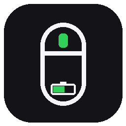

# LAMZU Battery



[](https://github.com/lavandiI/lamzu-battery/releases/latest)
[](https://github.com/lavandiI/lamzu-battery/actions/workflows/tests.yml)
[](LICENSE)
[](#)

**English** | [Русский](README.ru.md)

A tiny battery indicator for LAMZU mice that lives in the Windows system tray.
It talks directly to the USB dongle or cable, requires no driver and does not
need the official Lamzu software to be running.

**[Download LamzuBattery.exe for Windows 10/11](https://github.com/lavandiI/lamzu-battery/releases/latest/download/LamzuBattery.exe)**

---


The app is universal: the model is detected from VID/PID and the product
string, and the protocol from the control HID interface. Both known Lamzu
families are supported:

- **Compx** — Thorn, Atlantis, Maya and other Compx/Nordic mice;
- **Aurora** — Maya X, Inca, Paro, Maya Champion and other recent models.

Tested on a LAMZU Thorn while charging over cable (`3554:F50F`, Compx).
Aurora support is based on public protocol descriptions
([mouse_tray](https://github.com/Fan4Metal/mouse_tray),
[lamzu-ctl](https://github.com/anany1702/lamzu-ctl)), but has not been tested on
real Aurora hardware here.

## Features

- battery percentage as **large digits** directly on the tray icon;
- a condensed font is used for the three-digit `100`, so the digits stay large;
- **precise percentage with 1% steps** for Compx: it is calculated from the
  battery voltage using the same curve as the official LAMZU software;
- bold colours without an outline: blue — normal, yellow — ≤ 30%,
  red — ≤ 15%, dark green — charging, light blue — no fresh data;
- **UI language switch** between English and Russian (menu → Language); the
  choice is remembered, and the system language is used on first run;
- **charging animation**: a highlight moves across the battery bar in the
  desktop overlay; the tray colour stays solid;
- tooltip with model, percentage and state (`discharging`, `charging`, `full`);
- the menu shows the detected model, for example `LAMZU Thorn`;
- notifications on low battery and when fully charged;
- optional desktop overlay (draggable, always on top);
- start with Windows;
- detects cable/dongle plug and unplug immediately and refreshes the state;
- no administrator rights and nothing installed system-wide.

Updates every **30 minutes**. While charging, it checks once a minute so it does
not miss 100%. If the mouse is asleep and does not answer, it retries every
20 seconds — including before the first reading after startup. Cable and dongle
changes are watched separately and refresh the state immediately. You can also
press **Refresh now** in the menu at any time.

## Quick start

1. Download `LamzuBattery.exe` from the
   [Releases](https://github.com/lavandiI/lamzu-battery/releases/latest) page.
   Python and installation are not required — it is a single executable.
2. Run it. The icon appears in the notification area. Windows 11 often hides
   new icons under “^” — drag it onto the taskbar.
3. Right-click the icon for the menu: refresh, desktop overlay, autostart, exit.

You do not need to run the official Lamzu software: mouse settings are stored on
the device. The file is unsigned, so Windows SmartScreen may show a warning —
this is normal for small open-source projects.

## Supported models

| Family | Examples | Protocol | Status |
| --- | --- | --- | --- |
| Compx | Thorn, Atlantis, Maya, 1K/4K/8K dongles `3554:F50D/F50F/F510` | report ID 8, usage page `0xFF02` | Thorn tested; others use the common Compx protocol |
| Aurora | Maya X (`373E:001E/001C`), Inca (`37B0:0010/0009`), Paro, Maya Champion | feature report, usage page `0xFFFF`, interface 2 | based on the public protocol, not tested on hardware |

The model comes from the product string (`LAMZU THORN` → `Thorn`) or from a
table of known VID:PIDs. If the mouse is connected through a dongle that
identifies itself simply as `Receiver`, the app shows the neutral
`LAMZU Battery` name. With a cable connected the model is usually detected more
reliably.

## Why the value sometimes turns light blue

The mouse sleeps when idle and does not answer queries until it is moved. The
app shows the last known value in light blue and retries every 20 seconds. Move
the mouse and press **Refresh now** — the value updates immediately. After a
successful reading, the next normal poll is in 30 minutes. This is a hardware
limitation, not a bug.

## Where data is stored

Next to the executable:

```
data\status.json   — last state (read by the desktop overlay)
data\settings.json — selected UI language
data\app.log       — log
data\overlay.json  — desktop overlay position
```

If the executable directory is not writable (for example, `Program Files`),
`%LOCALAPPDATA%\LamzuBattery` is used instead.

## Autostart

Menu → **Start with Windows**. Adds a `LamzuBattery` value under
`HKCU\Software\Microsoft\Windows\CurrentVersion\Run`. Pressing it again disables
autostart. Administrator rights are not required.

On the first run of the new version, the old `LamzuThornBattery` autostart entry
is migrated to `LamzuBattery` automatically.

## Uninstall

1. Menu → **Exit**.
2. If autostart was enabled, turn it off in the menu first.
3. Delete the program folder.

## How it works

No driver is needed: the mouse or dongle exposes a regular HID interface with a
vendor-defined usage page. Only read-only battery queries are used, just like
the official software.

### Compx

| Field | Value |
| --- | --- |
| VID:PID | `3554:F50D` (1K dongle), `3554:F50F` (cable/charging), `3554:F510` (4K/8K dongle, tentative) |
| HID usage page | `0xFF02` |
| Report ID | `8`, 17 bytes |
| Command | `4` — battery / charging status |
| Request | `08 04 00 00 00 00 00 00 00 00 00 00 00 00 00 00 49` |
| Response | `08 04 00 00 00 02 <level> <state> <voltage hi> <voltage lo> ... <checksum>` |
| State | `0` — discharging, `1` — charging, `2` — full |
| Voltage | bytes 8–9, big-endian millivolts |
| Level | byte 6, coarse percentage in 5% steps (fallback) |

Checksum: `(0x55 - sum(first 16 bytes)) & 0xFF`.

The voltage is converted to a percentage with the official `BatteryParam`
curve from LAMZU's `Config.ini`, interpolated to 1% steps. If the voltage is
missing or implausible, the app falls back to the coarse level byte.

### Aurora

| Field | Value |
| --- | --- |
| VID:PID | `373E:001E/001C` (Maya X), `37B0:0010/0009` (Inca), Paro, Maya Champion |
| HID usage page | `0xFFFF`, interface `2` |
| Report | 65-byte feature report with report ID `0` |
| Current command | `0x83` at byte 6 |
| Legacy command | `0x8F` at byte 3 (fallback) |
| Response | tag `0xA1`; state and percent at bytes 7/8 (current) or 5/6 (legacy) |
| State | `0` — discharging, `1` — charging, `2` — full |

The commands only read state. Settings, DPI, profiles, polling rate and firmware
are not modified.

## Building from source

Requires Python 3.10+ and internet access to install packages:

```bat
git clone https://github.com/lavandiI/lamzu-battery.git
cd lamzu-battery
python -m pip install -r requirements-dev.txt
python make_icon.py
build.bat
```

Result: `dist\LamzuBattery.exe` (a single file, no Python installation needed).

Run from source:

```bat
pythonw app.py
```

Tests (protocol parsers and request layouts, no hardware access):

```bat
python -m pytest -q
```

Diagnostics (lists all Lamzu HID interfaces, model and protocol, and tries to
read the battery):

```bat
python diagnose.py
```

## Limitations

- Windows only.
- Aurora is implemented from public descriptions and has not been tested on a
  real Aurora mouse. If your model does not respond, please attach the output of
  `python diagnose.py` to an issue.
- Compx 4K/8K dongle support (`F510`) is tentative: the Compx protocol is
  usually the same, but it has not been tested on that specific dongle.
- The model may not be detected through a dongle that identifies itself as
  `Receiver`; the battery percentage is still read.
- If the mouse is off or the dongle is unplugged, the app shows `?`.
- Antivirus software may flag an unsigned PyInstaller executable — this is a
  common warning for self-built applications.

## Alternatives

If you do not want to build it yourself, there are universal tray indicators:
[HaloBattery](https://github.com/HeyOkay/HaloBattery),
[mouse_tray](https://github.com/Fan4Metal/mouse_tray) and
[lamzu-ctl](https://github.com/anany1702/lamzu-ctl). This project has few
dependencies and is focused specifically on Lamzu.

## Contributing

Issues and pull requests are welcome. If your Lamzu model is not detected or
does not report its battery, include the output of `python diagnose.py` and the
mouse model in the issue — it makes adding support much easier.

## License

[MIT](LICENSE). This project is not affiliated with LAMZU; it uses only
publicly documented read-only HID battery queries.
