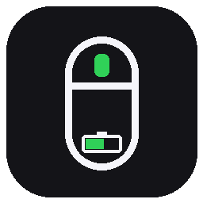

# LAMZU Battery



**Русский** | [English](README.md)

Маленький индикатор заряда мышей LAMZU в системном трее Windows. Приложение
общается напрямую с USB-донглом или кабелем, не требует драйвера и не нуждается
в запущенном официальном ПО LAMZU.

**[Скачать LamzuBattery.exe для Windows 10/11](https://github.com/lavandiI/lamzu-battery/releases/latest/download/LamzuBattery.exe)**

---


## Возможности

- процент заряда **крупными цифрами** прямо на иконке трея;
- **точность до 1 %** для Compx при разряде: значение считается по напряжению
  батареи с той же кривой, что в официальном ПО LAMZU; при зарядке выше 80 %
  используется 5 %-й уровень устройства, а 100 % показывается только если само
  устройство сообщает raw-уровень 100;
- цвета без обводки: синий — норма, красный — ниже 30 %, тёмно-зелёный —
  зарядка, светло-голубой — нет свежих данных; на светлой панели задач палитра
  темнее (контраст не ниже 4.5:1);
- **переключение языка** интерфейса (English/Русский); выбор запоминается, при
  первом запуске берётся язык системы;
- **автообновление**: проверка GitHub Releases при старте и раз в 6 часов,
  проверка SHA-256, замена exe на месте, health-check нового экземпляра и
  откат; автоматическую установку можно отключить в меню;
- подсказка с моделью, процентом и состоянием, уведомления о низком заряде и
  полной зарядке;
- на Windows 11 22H2+ иконка закрепляется на панели задач, если пользователь её
  не скрывал; пункт **Показать иконку на панели задач** возвращает её вручную;
- запуск при входе в систему;
- мгновенная реакция на подключение и отключение кабеля/донгла;
- диагностика: `LamzuBattery.exe --diagnose [--raw]`;
- без прав администратора, драйвера и телеметрии, ничего не устанавливается в
  систему.

## Быстрый старт

1. Скачайте `LamzuBattery.exe` со страницы
   [Releases](https://github.com/lavandiI/lamzu-battery/releases/latest).
2. Запустите файл и откройте меню правой кнопкой по иконке.
3. При необходимости включите **Запускать при входе**, **Показать иконку на
   панели задач**, выберите **Язык**.

Файл не подписан, поэтому SmartScreen может показать предупреждение — это
нормально для небольших open-source проектов.

## Поддерживаемые модели

| Семейство | Примеры | Протокол | Статус |
| --- | --- | --- | --- |
| Compx | Thorn, Atlantis, Maya, донглы 1K/4K/8K `3554:F50D/F50F/F510` | report ID 8, usage page `0xFF02` | Thorn (кабель и 1K-донгл) проверен; остальные используют общий протокол Compx |
| Aurora | Maya X (`373E:001E/001C`), Inca (`37B0:0010/0009`), Paro, Maya Champion | feature report, usage page `0xFFFF`, интерфейс 2 | по публичному описанию протокола, на железе здесь не проверялась |

Модель определяется по product string (`LAMZU THORN` → `Thorn`) или по таблице
известных VID:PID. Если донгл представляется как `Receiver`, показывается
нейтральное имя `LAMZU Battery`, но заряд всё равно читается.

Подробные таблицы протоколов — в [README.md](README.md#how-it-works).

## Опрос

Обычно раз в **5 минут**, при зарядке — раз в минуту, чтобы не пропустить 100 %.
Если мышь спит и не отвечает, повтор каждые 20 секунд. Подключение кабеля и
донгла отслеживается отдельно каждые 5 секунд. Пункт **Обновить заряд вручную**
опрашивает мышь немедленно.

## Где хранятся данные

Рядом с исполняемым файлом:

```
data\status.json   — последнее состояние и маркер health-check обновления
data\settings.json — язык интерфейса и режим обновлений
data\app.log       — журнал (ротация на 256 КиБ)
data\crash.log     — отчёты о падениях
```

Если папка программы недоступна для записи (например, `Program Files`),
используется `%LOCALAPPDATA%\LamzuBattery`.

## Автозапуск

Меню → **Запускать при входе** пишет значение `LamzuBattery` в
`HKCU\Software\Microsoft\Windows\CurrentVersion\Run`. Права администратора не
нужны. Старое значение `LamzuThornBattery` переносится автоматически.

## Обновления

Через ~8 секунд после старта и далее раз в 6 часов приложение запрашивает
GitHub Releases. Если версия новее:

1. проверяются папка и свободное место;
2. `LamzuBattery.exe` скачивается рядом с текущим файлом (прогресс — в подсказке
   трея);
3. сверяются SHA-256 из GitHub, размер и сигнатура `MZ`;
4. текущий exe становится `LamzuBattery.old.exe`, новый занимает его место,
   приложение перезапускается с `--wait-for-instance`;
5. новый экземпляр должен в течение 30 секунд сообщить о рабочем трее; иначе
   предыдущая версия восстанавливается, а ошибка пишется в журнал.

Копия для отката удаляется примерно через час после успешного старта (или при
следующем запуске, если она старше суток). Пункт **Устанавливать обновления
автоматически** можно выключить — тогда приложение только уведомляет, а в меню
появляется **Установить X.Y.Z**. Релиз без SHA-256 `digest` в API отклоняется
намеренно.

## Производительность

Версия 1.6.0 полностью переписана на Rust (Python/PyInstaller-сборка осталась в
истории git). Замеры на одной машине и одной мыши — в
[docs/benchmark.md](docs/benchmark.md):

| | Python 1.5.11 | Rust 1.6.0 |
| --- | ---: | ---: |
| Размер загрузки | 16,33 МиБ | **2,61 МиБ** |
| Распаковка при старте | 31,4 МиБ, 69 файлов | **нет** |
| Готовность трея | 700 мс | **301 мс** |
| Первое показание | 700 мс | **301 мс** |
| Пик private-памяти | 27,9 МиБ | **5,6 МиБ** |
| Выход второго экземпляра | 647 мс | **20 мс** |
| `--diagnose` | 200 мс | **96 мс** |
| CPU в простое (одно ядро) | 0,2–0,3 % | 0,2–0,3 % |

## Сборка из исходников

Нужны Windows 10/11 x64, Rust 1.95+ с тулчейном `x86_64-pc-windows-msvc` и MSVC
Build Tools (у HID-библиотеки есть небольшая C-часть).

```bat
build.bat
```

Скрипт прогоняет `cargo fmt --check`, `cargo clippy --all-targets -- -D warnings`,
`cargo test`, затем `cargo build --release --locked` и копирует результат в
`dist\LamzuBattery.exe`.

Запуск из исходников и тесты:

```bat
cargo run --release
cargo test
cargo test --test live -- --ignored --nocapture
cargo run --example preview
```

## Диагностика

```bat
LamzuBattery.exe --diagnose [--raw] [--lang ru|en]
```

Показывает все HID-интерфейсы LAMZU, определённый протокол и модель, а также
заряд; `--raw` дополнительно печатает сырые отчёты. Код возврата 1, если
интерфейс не найден или мышь не ответила. Приложите вывод к issue.

## Ограничения

- Только Windows.
- Aurora реализована по публичному описанию и не проверялась на реальном
  устройстве.
- Поддержка донглов Compx 4K/8K (`F510`) предварительная.
- Установка обновления покрыта тестами с локальным HTTP-сервером и проверкой
  `--wait-for-instance`, но живое обновление «релиз → релиз» ещё не выполнялось.
- exe не подписан, SmartScreen может предупреждать.

## Лицензия

[MIT](LICENSE). Проект не связан с LAMZU и использует только публично
описанные read-only HID-запросы заряда.
